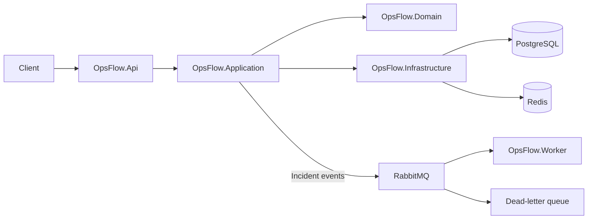

# OpsFlow

OpsFlow is a multi-tenant incident management API built with ASP.NET Core. It models organizations, teams, services, incidents, deployments, and audit history, with JWT authentication, PostgreSQL persistence, Redis caching, and RabbitMQ-based background notifications.

> **Project status:** learning and portfolio project. The seeded accounts and local connection defaults are for development only. Do not use them in a deployed environment.

## What it demonstrates

- Layered .NET architecture with Domain, Application, Infrastructure, API, and Worker projects.
- Organization-scoped teams, services, users, and incidents.
- Incident lifecycle rules, status transitions, assignments, comments, timeline events, resolution, reopening, and postmortems.
- JWT access and refresh-token flows, role-based authorization, and BCrypt password hashing.
- PostgreSQL persistence through Entity Framework Core migrations.
- Redis-backed caching.
- RabbitMQ event publishing, a separate background consumer, manual acknowledgements, bounded retries, and a dead-letter queue.
- Audit records for important operations.

## Architecture



The API saves an incident or status change, then publishes a message to RabbitMQ. The Worker consumes the message separately from the HTTP request and logs a notification. If processing repeatedly fails, the message is routed to the dead-letter queue for inspection.

## Solution layout

| Project | Responsibility |
| --- | --- |
| `OpsFlow.Domain` | Core entities, enums, state-transition rules, and repository contracts. |
| `OpsFlow.Application` | Use cases, DTOs, service contracts, mapping, and message contracts. |
| `OpsFlow.Infrastructure` | EF Core/PostgreSQL, repositories, authentication implementation, Redis, and RabbitMQ publisher. |
| `OpsFlow.Api` | HTTP controllers, JWT authentication/authorization, Swagger, and startup database migration/seeding. |
| `OpsFlow.Worker` | Background RabbitMQ consumer for incident notifications. |

## Requirements

- .NET 8 SDK
- PostgreSQL
- Redis
- RabbitMQ 4.x (the configured main queue uses quorum-queue delivery limits)

The default local endpoints and development settings are in each app's `appsettings.json`. Override them with environment variables or local settings when your services use different credentials or ports. In .NET configuration, nested settings use double underscores in environment-variable names.

For example, in PowerShell:

```powershell
$env:ConnectionStrings__DefaultConnection = "Host=localhost;Port=5432;Database=opsflow_db;Username=opsflow_user;Password=<your-local-password>;"
$env:Redis__ConnectionString = "localhost:6379"
$env:RabbitMq__HostName = "localhost"
$env:RabbitMq__Port = "5672"
$env:JwtSettings__SecretKey = "replace-with-a-random-secret-of-at-least-32-bytes"
```

The JWT secret must be at least 32 UTF-8 bytes. Keep real secrets in environment variables or a secret manager; do not commit them.

## Run locally

1. Start PostgreSQL, Redis, and RabbitMQ.
2. Set the connection string and JWT secret using the environment variables above. Adjust the Redis and RabbitMQ settings if needed.
3. Start the API:

   ```powershell
   dotnet run --project OpsFlow.Api/OpsFlow.Api.csproj --launch-profile http
   ```

   On startup, the API applies pending EF Core migrations. If the database has no organizations, it also inserts development sample data.

4. In a second terminal, start the notification consumer:

   ```powershell
   dotnet run --project OpsFlow.Worker/OpsFlow.Worker.csproj
   ```

5. Open Swagger at [http://localhost:5153/swagger](http://localhost:5153/swagger). RabbitMQ management is commonly available at [http://localhost:15672](http://localhost:15672) when using the management-enabled RabbitMQ image.

Build the full solution with:

```powershell
dotnet build OpsFlow.sln
```

## Development login

On a fresh, local development database, the seeder creates this sample administrator:

```text
Email:    admin@acmetech.io
Password: Admin@1234!
```

Other seeded roles have sample accounts in `OpsFlow.Infrastructure/Data/OpsFlowDbSeeder.cs`. These credentials are public demo data, not production credentials. Do not deploy the seeder's default accounts as-is.

## API areas

All routes are under `/api`. Main areas include:

- `/api/auth` — register, login, refresh, and revoke tokens.
- `/api/organizations` — organization management.
- `/api/organizations/{orgId}/teams` — teams and team members.
- `/api/organizations/{orgId}/services` — service management and status.
- `/api/organizations/{orgId}/incidents` — incident creation, listing, timeline, comments, assignment, and lifecycle actions.
- `/api/organizations/{orgId}/deployments` — deployment records and status changes.
- `/api/organizations/{orgId}/audit-logs` — organization audit history.

Swagger shows request/response schemas and authorization requirements for each endpoint.

## RabbitMQ event flow

The API publishes `incidents.created` and `incidents.status_changed` messages. The topic exchange routes them to the durable `opsflow.notifications` quorum queue. The Worker uses manual ACK so a message is removed only after successful processing. Failed messages are retried up to three times with a retry-count header; after the retries are exhausted, the Worker routes the message to `opsflow.notifications.dlq`.

The Worker keeps processed message IDs in memory. This prevents duplicate handling during one process lifetime, but that set is lost if the Worker restarts. The API currently commits the database change before publishing its event; a transactional outbox would close the gap where the database save succeeds but RabbitMQ is unavailable.

## Verification

The solution has been built successfully with `dotnet build OpsFlow.sln`. The API-to-Worker flow was also exercised locally for incident creation and status change, and a malformed message was verified to reach the dead-letter queue after the configured retries.
